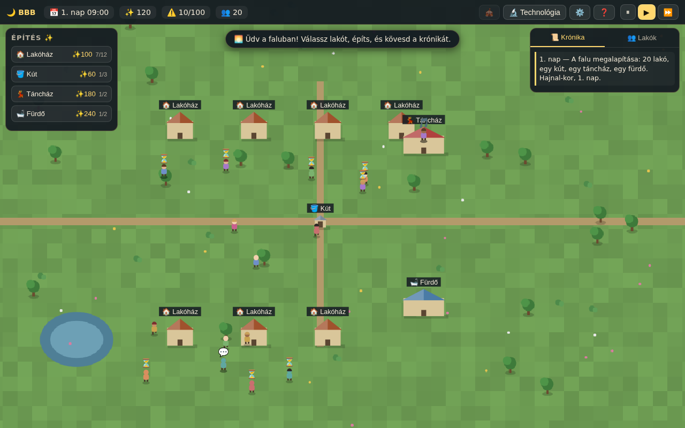
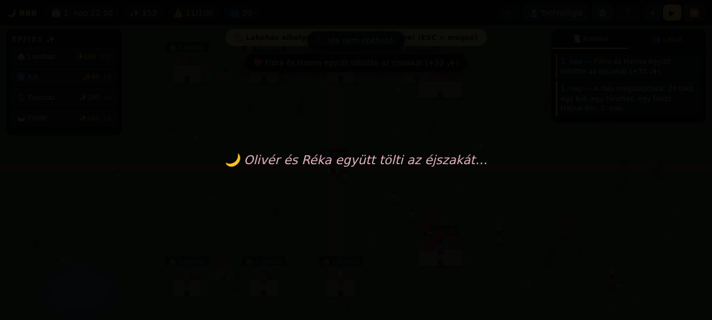

# 🌙 Bárhol Bármikor Bárkivel

> Életszimulátor arról, hogy **a falu motorja a szerelem**. Segíts 20 telepesnek boldogulni a Hajnal-korban: építs helyszíneket, hagyj teret a kapcsolatoknak, szüreteld az ✨ Inspirációt — és vigyázz, a féltékenység felégetheti a közösséget!

**Játszható vertikális szelet 0.1** — böngészőben fut, telepítés nélkül.



## Játékmenet

```
Megfigyeled az igényeket → épületsz (kút, táncház, fürdő, lakóház)
→ a lakók maguktól ismerkednek (Utility AI) → együtt töltik az éjszakát
(fade-to-black) → boldogságukból ✨ Inspiráció fakad → amiből új épületek
és technológiák jönnek → és a krónika mindent feljegyez…
```

- **✨ Inspiráció** — a boldog találkozásokból termelődik, de naponta 20%-át elveszíti: az élő kapcsolat a nyersanyag.
- **⚠️ Feszültség** — a féltékenységből és a kielégítetlenségből nő; 80 felett sztrájk tör ki.
- **❤️ Kémia** — rejtett páronkénti érték: közös tánc, beszélgetés és együttlétek növelik.
- **Nemzedékek** — a mély kötelékekből gyerekek születnek, akik felnőve a falu tagjai lesznek.
- **Tartalom csúszka** — Romantikus / Csípős / Meglepetésmentes. Minden intim jelenet fade-to-black; minden romantikus szereplő felnőtt. Lásd a [tartalmi szabályzatot](docs/tartalmi-szabalyzat.md).

## Futtatás

**Egyszerűen:** nyisd meg az [`index.html`](index.html)-t böngészőben — build-lépés nincs.

Vagy szerverrel:
```bash
python3 -m http.server 8080
# majd: http://localhost:8080
```

**Irányítás:** kattintás = lakó kiválasztása · húzás = mozgás · görgő/csippentés = zoom · 📍Követ = kamera rögzítése · szóköz = szünet · ESC = mégse. Mobilon is játszható.

## Fejlesztés

A szimulációs mag (`js/sim.js`) tiszta logika — böngészőben és Node-ban is fut:

```bash
node tests/sim.test.js   # 45 szimulációs ellenőrzés
node scripts/bundle.js   # egyfájlos csomag itch.io-hoz → dist/
```

Konzol-horog a futó játékban: `window.__BBB.vilag()`, `window.__BBB.kamera()`, `window.__BBB.epites(tipus, x, y)`.

## Dokumentáció

| Dokumentum | Tartalom |
| --- | --- |
| [docs/GDD-v2.md](docs/GDD-v2.md) | Teljes tervezői dokumentum: core loop, erőforrások, agent modell, **hét korszak tech-fákkal**, robotok, UFO-k |
| [docs/vertikalis-szelet.md](docs/vertikalis-szelet.md) | Mit tartalmaz pontosan a 0.1-es szelet |
| [docs/utiterv.md](docs/utiterv.md) | M0–M6 útiterv: itch.io, Steam, modding |
| [docs/tartalmi-szabalyzat.md](docs/tartalmi-szabalyzat.md) | Fade-to-black, csúszka, gyerek-zárolás — rögzített szabályok |

## Éjszakai üzenet



## Státusz

- ✅ M0 vertikális szelet: játszható, tesztelt
- 🔜 M1: mentés/betöltés, pletkyaháló, új techek
- 📖 Teljes útiterv: [docs/utiterv.md](docs/utiterv.md)

## Licenc

MIT — lásd [LICENSE](LICENSE). A projekt fikció; minden szereplő és esemény kitalált.
